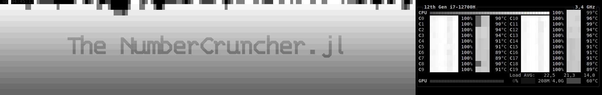

# The NumberCruncher.jl



>"Patience is a tree whose root is bitter, but its fruit is very sweet."

Welcome to another one of my pet projects! 🚀  
This time we will explore a couple of time series and try to **fiddle with the data they might contain**.  
The main purpose of this project is to **create a data estimator**.

---

## 📦 How to Use This Project

1. **Install Julia**  
   Make sure you have [Julia](https://julialang.org/downloads/) installed.

2. **Clone the repository**  
   ```bash
   git clone https://github.com/arielkonopka/NumberCruncher.jl.git
   ```

   Only the Bitcoin download needs a [CryptoCompare](https://min-api.cryptocompare.com/) API key. Set the `CRYPTOCOMPARE_KEY` environment variable, or copy `config/cryptocompare_key.txt.example` to `config/cryptocompare_key.txt` and put the key in it, alone on one line (that file is git-ignored; never commit it).

3. **Run Julia**  
   Start Julia in the project directory and enter package mode:
   ```julia
   ]
   ```

4. **Activate the environment**  
   ```julia
   activate _your_path_
   ```

5. **Instantiate dependencies**  
   ```julia
   instantiate
   ```

6. **Run the project**  
   Back in Julia REPL:
   ```julia
   using NumberCruncher
   r = do_the_thing2(100, 30, 50; seed=1)   # last 100 points, max delay 30, k = 50
   summarize(r)                              # skill vs. the zero and persistence predictors
   ```

7. **Now you got the data**
*r* variable contains the dataframe, that was created during the "do_the_thing2" function run: the estimate and the real value of each hidden point, the persistence baseline, the delays and the Theiler window. `summarize(r)` reports MAE against the zero predictor and persistence, the hit rate of the sign and its binomial p-value. The same `seed` gives the same result. `do_the_thing` runs the slower grid search over the embedding size and k. You can speed upp your calculations by increasing the number of the threads by invoking:

```bash
julia -t threads
```
Where *threads* is the number of concurrent instances, you would like to allow on your system.

## 🖥️ Browser GUI

```bash
julia -t 6 --project=. -e 'using NumberCruncher; serve_gui()'
```
Then open <http://127.0.0.1:8080>. The GUI listens on localhost only (it has no authentication); pass `port=` to change the port.

- **Data**: import stock and index prices (Yahoo Finance, unofficial endpoint), FRED series (`SP500`, `DJIA`, `VIXCLS`, …), hourly weather from the Open-Meteo archive, Bitcoin from CryptoCompare (needs the key), generate a Lorenz attractor, or upload any CSV. Every file lands in `data/`. A *dataset* is a file, a numeric column and a preparation: raw values, first differences or log returns, optionally with added noise.
- **Run**: walk-forward test over the last *N* points, scoring several k values from each PECUZAL reconstruction; can be stopped.
- **Results**: MAE, RMSE, hit rate and correlation against naive baselines (zero, persistence, window mean), estimate-vs-real and error charts, scores per embedding dimension, CSV export.
- **Phase space**: the reconstruction at one offset in 2-D/3-D with the last point, its neighbours, their successors, the estimate and the real next point.

The same pipeline works without the GUI on any series:
```julia
using NumberCruncher
L = NumberCruncher.DataManager.GenerateLorenz(N=20000, Δt=0.01)
s = NumberCruncher.Preprocessor.prepare_series(L.x; transform=:raw).series
r = run_series(s, 1; msize=40)                  # hold out the last value
e = NumberCruncher.analyzeit2(r.Y, s, r.tau_vals, 1; k=30)
e.center[e.searchedIndex], r.realPoint[e.searchedIndex]   # estimate, real
```

### Resampling, volatility normalisation and targets

`do_the_thing2` (and the GUI) can also:

- **resample** before differencing, e.g. changes of BTC's daily mean price:
  `do_the_thing2(200, 30, 25; aggregate=:daily, stat=:mean)`. Differences of averages are
  autocorrelated even for a random walk (lag-1 ≈ 0.25), so compare against the AR(1) baseline,
  not only against zero.
- **normalise by volatility**: `normalize=:ewma` (`ewma_lambda=0.98`) or `:rolling`
  (`vol_window=168`) embeds z = r/σ, where σ is estimated from past values only, after a burn-in
  (`vol_burnin=500`). Estimates are converted back with σ, so all scores stay in the original scale
  (`est_z`/`real_z` hold the normalised ones). `normalize=:none` gives exactly the old results.
- **forecast volatility**: `target=:abs_return` estimates |r|. Its baselines are the EWMA forecast
  σ·√(2/π) and persistence |r_t|; `summarize` reports skill against them and the share of points
  where the model beats EWMA.
- **switch off shadow weighting**: `shadow=false` weights the successors by embedding distance
  only (plain k-NN analogues).

```julia
r = do_the_thing2(2000, 10, 100; column=:close, transform=:logdiff, normalize=:ewma,
                  target=:abs_return, datafile="data/bitcoin_hourly_data_test_data.csv")
summarize(r)
```
In the GUI, target, scale and shadow are switches on the Results tab: each point stores every
variant, so changing them needs no rerun.

## Your PC's Personal Workout: A High-Intensity Benchmark

Be aware that this program is a resource-intensive benchmark. It will consume a significant amount of your CPU and RAM. It is not recommended to run it with a large number of threads unless you have ample memory. While I intend to refactor it for better efficiency, for now, please proceed with caution. I found that running with six threads was a safe setting for all my measurements.

After executing the *do_the_thing* function, the program will generate benchmark data for approximately 1000 points. The results are a reconstruction of the phase space from the input data, achieved by employing the [PECUZAL (Prediction Error of Coupled Units with a Zonal Adaptive Learning) algorithm](https://iopscience.iop.org/article/10.1088/1367-2630/abe336). 📈

Once the phase space is reconstructed, the next step involves estimating the subsequent data point. This is done by first identifying the neighbors of the last known point. A weighted average is then calculated, where the weights are determined by a combination of the neighbor's distance and the distance to the remaining known coordinates of the neighbor's successor.

All collected data, including factors like the number of neighbors and maximal temporal shift, are included in the output DataFrame. You can easily save this data to a CSV file using the following Julia code:

```Julia

using CSV
CSV.write("yourfilename", df)
```

You will have the data, with the estimated values and real values, along with the distances to the real values. There is also added a visualization part, but it is not ready yet.


